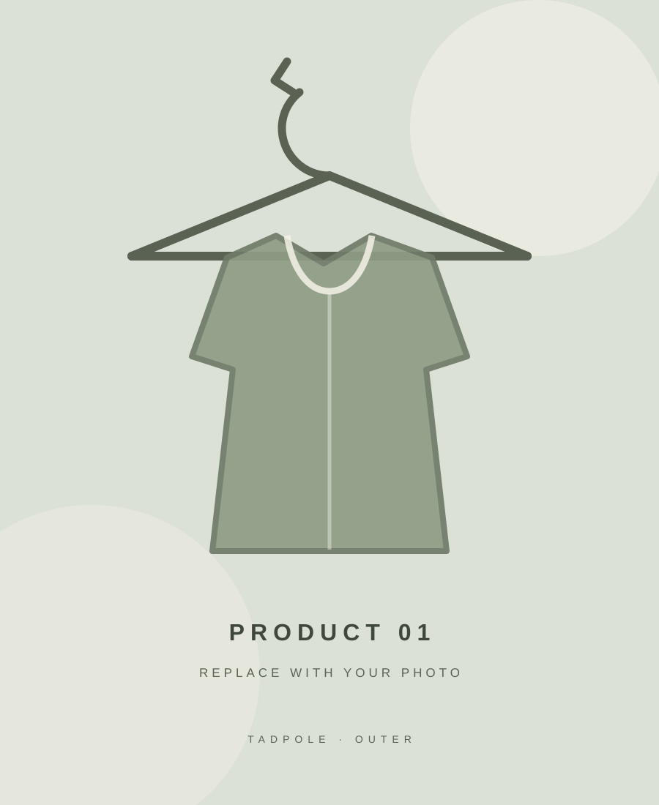

# Tadpole — Demo Clothing Shop

QA 포트폴리오 제작을 위해 만든 가상의 의류 쇼핑몰 프론트엔드입니다.
메인 쇼핑 화면과 로그인 화면을 포함하며, 이미지 파일을 교체해 나만의 쇼핑몰로 꾸밀 수 있습니다.

## 1. 실행 방법

1. 이 저장소를 다운로드하거나 GitHub에서 Clone 합니다.
2. `index.html` 파일을 브라우저에서 엽니다.
3. 메인 화면의 `LOGIN`을 누르면 `login.html`로 이동합니다.

별도의 서버나 패키지 설치 없이 실행할 수 있는 HTML/CSS/JavaScript 데모입니다.

## 2. 폴더 구조

```text
Tadpole/
├── index.html              # 쇼핑몰 메인 화면
├── login.html              # 로그인 화면
├── signup.html             # 회원가입 화면
├── css/
│   └── style.css           # 전체 스타일 및 반응형 레이아웃
├── js/
│   ├── main.js             # 카테고리 필터, 검색, 장바구니 데모 등
│   ├── login.js            # 로그인 처리 데모
│   └── signup.js           # 회원가입 처리 데모
└── assets/
    └── images/             # 사진 및 이미지 자리표시자
```

## 3. 상품 사진 바꾸는 방법

사진은 `assets/images/` 폴더에 넣습니다.

예를 들어 첫 번째 상품 사진을 바꾸려면:

1. 원하는 사진을 `assets/images/product-01.jpg`라는 이름으로 저장합니다.
2. `index.html`에서 다음 부분을 찾습니다.

```html

```

3. `src`를 아래처럼 바꿉니다.

```html

```

같은 방법으로 아래 파일을 교체할 수 있습니다.

| 이미지 파일 | 사용 위치 |
|---|---|
| `hero-image.svg` | 메인 상단 큰 배너 |
| `category-outer.svg` | 아우터 카테고리 |
| `category-tops.svg` | 상의 카테고리 |
| `category-bottoms.svg` | 하의 카테고리 |
| `category-acc.svg` | 액세서리 카테고리 |
| `product-01.svg` ~ `product-08.svg` | 상품 카드 8개 |
| `editorial-image.svg` | 하단 브랜드 배너 |
| `login-image.svg` | 로그인 페이지 왼쪽 이미지 |

사진을 바꿀 때는 `src` 파일명과 실제 이미지 파일명이 정확히 일치해야 합니다. 이미지 비율은 세로형(약 3:4)을 권장하고, 메인 배너는 가로형 이미지를 권장합니다.

## 4. 현재 구현된 기능

- 카테고리별 상품 필터
- 상품명 검색
- 장바구니 담기 개수 표시(브라우저 내 데모 상태)
- 관심 상품 버튼(화면 상태 변경)
- 메인 페이지에서 로그인 페이지로 이동
- 아이디 중복 확인 및 회원가입
- 아이디/비밀번호 로그인 검증
- 브라우저별 회원정보 저장 및 세션 데모
- 비밀번호 표시/숨기기
- 회원가입 화면 비밀번호 입력란 위에 데모용 비밀번호 주의 문구 표시
- 모바일 화면 대응

## 5. 아직 구현되지 않은 기능

이 프로젝트는 프론트엔드 QA 데모입니다. 실제 서비스용 백엔드나 데이터베이스는 연결되어 있지 않습니다. 회원정보는 현재 브라우저의 localStorage에만 저장되며 다른 기기나 브라우저와 공유되지 않습니다. 비밀번호는 데모 편의를 위해 SHA-256 해시로 저장하지만, 클라이언트 코드와 브라우저 저장소는 사용자가 확인·변조할 수 있으므로 실제 서비스의 안전한 인증 수단이 아닙니다. 실제 개인정보나 사용 중인 비밀번호를 입력하지 마세요.

- 서버 기반 회원가입 및 계정 인증
- 실제 서비스 수준의 비밀번호 저장 및 세션 보안
- 서버에 저장되는 장바구니와 주문 정보
- 실제 결제 및 배송 처리
- 실제 뉴스레터 구독

회원가입 후 같은 브라우저에서 등록한 아이디와 비밀번호로 로그인 흐름을 테스트할 수 있습니다. 브라우저 데이터를 삭제하면 데모 계정도 삭제됩니다.

## 6. GitHub Pages로 게시하기

1. GitHub에 새 저장소를 생성합니다.
2. 이 폴더 안의 파일과 폴더를 저장소 최상위(root)에 업로드합니다.
3. 저장소의 **Settings → Pages**로 이동합니다.
4. **Build and deployment**에서 `Deploy from a branch`를 선택합니다.
5. Branch는 `main`, 폴더는 `/ (root)`를 선택하고 저장합니다.
6. 게시가 완료되면 GitHub Pages가 제공하는 주소에서 사이트를 확인합니다.

## 7. QA 포트폴리오 확장 아이디어

- 로그인 입력값 누락 / 공백 / 길이 테스트
- 카테고리 필터와 검색어 조합 테스트
- 장바구니 수량 및 상태 테스트
- 모바일 화면 레이아웃 테스트
- 의도적으로 오류를 추가한 뒤 TC 작성 및 버그 리포트 작성
- 추후 API와 데이터베이스를 연결한 뒤 API 테스트 추가

이 저장소는 QA 학습 및 포트폴리오 목적의 가상 쇼핑몰입니다.
